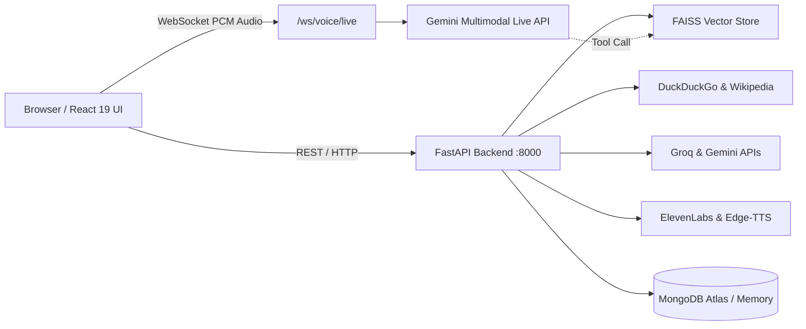

# AERIX AI — Multimodal RAG Co-Pilot, Real-Time Voice & 3D WebGL Studio

**AERIX** is a full-stack generative AI platform combining **multi-source Retrieval-Augmented Generation (RAG)**, **real-time bidirectional voice conversation** (English & Sri Lankan Sinhala), and an **in-browser Three.js 3D Studio**—containerized with Docker for reproducible deployment.

---

## Key Capabilities

### 1. Hybrid Multi-Source RAG Assistant
* **Tri-Source Grounding**: Combines local vector search (**FAISS** + `sentence-transformers/all-MiniLM-L6-v2` over PDF/Markdown knowledge bases), live web search (**DuckDuckGo**), and **Wikipedia** summaries.
* **Resilient LLM Fallback**: Routes chat completions through **Groq** with automatic model fallback (`qwen/qwen3.8-27b`, `openai/gpt-oss-120b`, `openai/gpt-oss-20b`).
* **Topic-Based Session Persistence**: Stores multi-turn conversations in **MongoDB Atlas** with automatic prompt-derived topic titles and seamless in-memory fallback when offline.

### 2. Real-Time Bilingual Voice Assistant (Live & Classic Modes)
* **Gemini Live Mode (`/ws/voice/live`)**: Full-duplex WebSocket audio relay streaming 16kHz mic PCM to **Gemini Multimodal Live API** (`gemini-2.5-flash-native-audio-preview-12-2025`) and playing 24kHz PCM responses with instant **barge-in** interruption, live transcripts, selectable voice personas (`Aoede`, `Zephyr`, `Puck`, `Charon`, `Kore`, `Fenrir`), and mid-call FAISS RAG tool calling.
* **Classic Hybrid Mode (`/voice/speak`)**: Routes **English** through **ElevenLabs** (`eleven_flash_v2_5`) and **Sinhala (`si-LK`)** through **Microsoft Neural Voices** (`si-LK-ThiliniNeural` / `si-LK-SameeraNeural` via `edge-tts`) with a custom Sinhala phonetic loanword dictionary and `gTTS` fallback.
* **Separate Voice Sessions**: Each voice session starts cleanly in its own new chat, accompanied by a Web Audio API frequency visualizer.

### 3. AERIX 3D Studio (Three.js / WebGL)
* **Prompt-to-3D Scene Generation (`/3d/generate`)**: Generates procedural Three.js code using **Gemini (`gemini-3.5-flash-lite`)** with spatial alignment rules, anti-Z-fighting offsets, and automatic Groq fallback.
* **Side-by-Side Workspace**: Toggle live Three.js script inspection beside the interactive `OrbitControls` WebGL viewport.
* **GLB Import & Export**: Drag-and-drop `.glb` / `.gltf` models directly onto the canvas with automatic bounding-box centering, or export generated scenes as binary `.glb` files.
* **Studio Lighting & Auto-Framing**: Built-in 3-point directional + hemisphere lighting rig, cyber ground grid, double-sided materials, and 3/4 hero camera auto-framing over a crimson-and-obsidian studio backdrop.

### 4. Rich Developer-Grade Chat UI
* **Animated Mermaid.js Diagrams**: Renders `mermaid` blocks into interactive dark-themed SVG cards with flowing edge animations and reactive hover glow.
* **GFM Tables & Code Highlighting**: Parses Markdown tables cleanly via `remark-gfm` and renders code blocks in **JetBrains Mono** with **PrismJS** syntax highlighting and one-click copy.
* **Obsidian & Crimson Aesthetic**: Pure-black minimal scrollbars, blur-glide reply fade-ins, inline message editing, and responsive sidebar navigation.

---

## System Architecture



---

## Repository Structure

```text
aerix-ai/
├── docker-compose.yml                  # Multi-container orchestration (Frontend + Backend)
├── backend/
│   ├── Dockerfile                      # Python 3.11-slim with CPU-only PyTorch
│   ├── app.py                          # FastAPI entrypoint & CORS middleware
│   ├── requirements.txt                # Python dependencies
│   ├── core/
│   │   └── config.py                   # Environment settings & model configs
│   ├── api/
│   │   ├── routes.py                   # REST & WebSocket endpoints
│   │   └── schemas.py                  # Pydantic request/response models
│   ├── services/
│   │   ├── llm_service.py              # Groq chat completion & prompt engineering
│   │   ├── rag_service.py              # Document chunking, embeddings & FAISS index
│   │   ├── search_service.py           # DuckDuckGo & Wikipedia search
│   │   ├── storage_service.py          # MongoDB Atlas + in-memory session storage
│   │   ├── voice_service.py            # ElevenLabs + Edge-TTS + Sinhala phonetics
│   │   ├── gemini_live_service.py      # Gemini Multimodal Live WebSocket relay
│   │   └── three_generator_service.py  # Gemini/Groq Three.js procedural generator
│   └── knowledge_base_pdfs/            # Indexed Markdown/PDF knowledge sources
└── frontend/
    ├── Dockerfile                      # Multi-stage Node 20 build -> Nginx Alpine
    ├── nginx.conf                      # Gzip, static asset caching & SPA fallback
    ├── package.json                    # React 19, Three.js, Mermaid, PrismJS
    └── src/
        ├── api/chatApi.js              # Axios REST & WebSocket URL helpers
        ├── components/ThreeCanvas/     # Three.js WebGL engine & GLB loader/exporter
        └── pages/
            ├── LandingPage/            # Hero, features & architecture overview
            ├── ChatPage/               # Sidebar, ChatPanel, MessageItem & VoiceAssistantModal
            └── ThreeStudio/            # Side-by-side 3D Studio workspace
```

---

## Tech Stack

| Layer | Technologies |
| :--- | :--- |
| **Frontend** | React 19, React Router 7, Three.js, WebGL, Web Audio API, Mermaid.js, PrismJS, `react-markdown`, `remark-gfm`, Lucide Icons |
| **Backend** | Python 3.11, FastAPI, Uvicorn, Pydantic, `httpx`, `google-genai`, `groq` |
| **RAG & Search** | FAISS (`faiss-cpu`), Sentence Transformers (`all-MiniLM-L6-v2`), PyPDF, DuckDuckGo (`ddgs`), Wikipedia |
| **Voice & Audio** | Gemini Multimodal Live API, ElevenLabs (`eleven_flash_v2_5`), Microsoft Neural (`edge-tts`), `gTTS` |
| **Database & DevOps** | MongoDB Atlas (`pymongo`), Docker, Docker Compose, Nginx Alpine |

---

## Quickstart

### Prerequisites
Create `backend/.env` with your API keys before starting:

```env
GROQ_API_KEY=your_groq_api_key
GROQ_MODEL=qwen/qwen3.8-27b
GEMINI_API_KEY=your_gemini_api_key
GEMINI_LIVE_MODEL=gemini-2.5-flash-native-audio-preview-12-2025
ELEVENLABS_API_KEY=your_elevenlabs_api_key
ELEVENLABS_VOICE_ID=EXAVITQu4vr4xnSDxMaL
ELEVENLABS_MODEL_ID=eleven_flash_v2_5
MONGODB_URI=your_mongodb_atlas_uri
```

*(Optional for frontend builds targeting a remote backend: set `REACT_APP_API_BASE=https://your-backend-url`.)*

---

### Option 1: Run with Docker Compose *(Recommended)*

```powershell
docker compose up --build -d
```

* **Frontend**: `http://localhost:3000`
* **Backend API Docs**: `http://localhost:8000/docs`
* **Health Check**: `http://localhost:8000/health`

Stop containers anytime with `docker compose down`.

---

### Option 2: Run Locally (Without Docker)

**Backend:**
```powershell
cd backend
python -m venv venv
.\venv\Scripts\Activate.ps1
pip install -r requirements.txt
uvicorn app:app --reload --port 8000
```

**Frontend:**
```powershell
cd frontend
npm install --legacy-peer-deps
npm start
```

---

## Author

**Ravindu Anjana** — Full-Stack & AI Systems Software Engineer  
GitHub: [ravinduanjana99](https://github.com/ravinduanjana99)
